# How to QA a PreQual Report

This page walks through `PDF/dtiQA.pdf` one page at a time and says what to look for on each. The example pages come from a single-shell (b=1000, 64 directions, one b0) scan with no reverse phase-encoded image, processed with a skull-stripped T1, so the report includes the Synb0-DisCo and TARDIS pages. Your report will have a slightly different set of pages depending on the options used; the conditional pages are listed at the [end](#pages-you-may-see-that-are-not-in-this-example).

The outputs themselves are described in [Outputs](OUTPUTS.md), and the processing behind each page in the [User Guide](USER_GUIDE.md#pipeline-quality-assurance-steps).

## The five-minute pass

If you only have a few minutes per scan, check these in order. Each one is explained in its own section below.

1. **Methods page.** Read the Warnings block. Confirm the inputs, phase encoding and readout time are what you expected.
2. **Preprocessing and Masks.** The preprocessed b0 should look undistorted and the cyan mask should follow the brain.
3. **Eddy page.** Look for motion spikes, dense outlier slices and bright rows or columns in the chi-squared matrix.
4. **Gradient Check.** The green crosses must sit on the blue crosses.
5. **Tensors and FA.** Corpus callosum red, corticospinal tract blue, white matter bright on the FA page.

A scan that passes these five is usually fine. The rest of the report tells you why a scan looks wrong when one of them fails.

## Page by page

### Methods

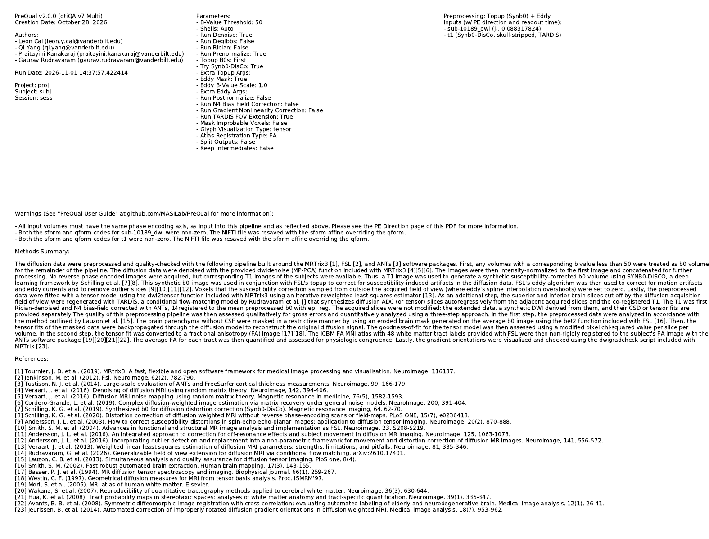

**What it shows.** The PreQual version, run date, every option used, the inputs with their phase encoding direction and readout time, the warnings the pipeline raised, and a methods paragraph with references that you can paste into a manuscript.

**Check.**

- The inputs are the scans you meant to process, with the phase encoding direction and readout time you expected. A wrong readout time or direction gives a plausible-looking but wrong susceptibility correction.
- The "Preprocessing" line tells you which distortion correction ran: Topup with a reverse phase-encoded image, Topup with a Synb0 synthetic b0, or Eddy only. "Eddy only" means no susceptibility correction at all; the frontal lobe and brainstem will stay distorted.
- Every line under Warnings. Some are routine (sform and qform both set, resaved with the sform) and some are not (volumes removed because of bad b-vectors, gain differences above 5 percent, eddy rerun on non-shelled data, TARDIS skipped or failed, topup skipped).

**In this example.** Topup ran on a Synb0 b0 because no reverse phase-encoded image was given. The only warnings are the routine sform/qform notes.

### PE Direction

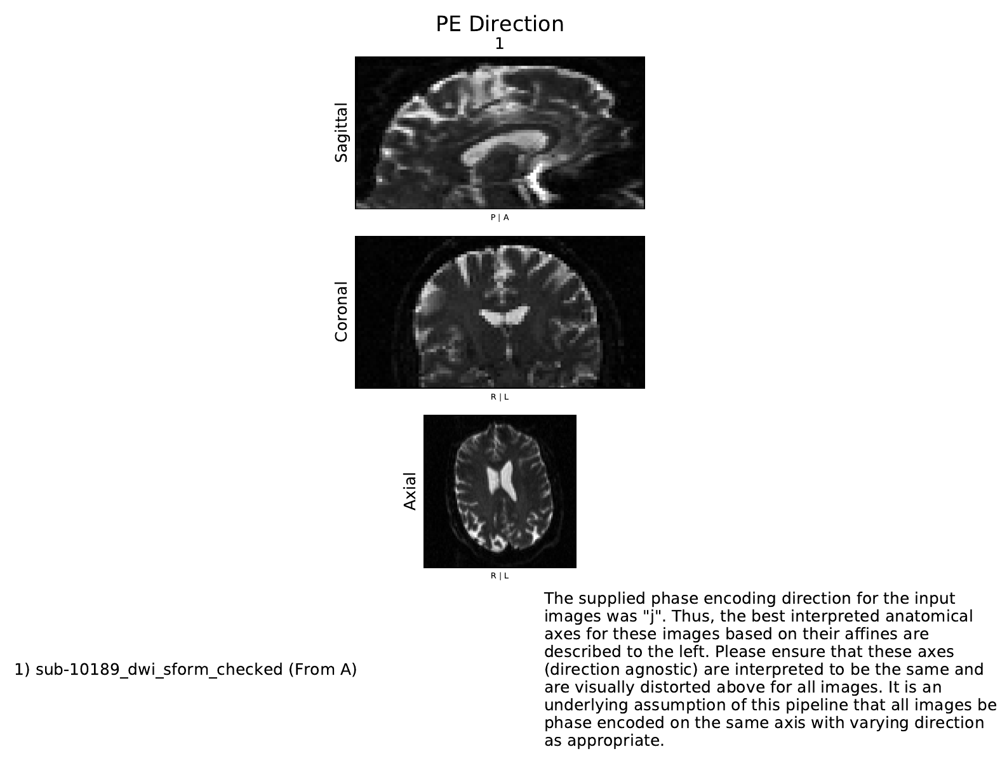

**What it shows.** The first b0 of each input scan, with the anatomical interpretation of the supplied phase encoding axis in parentheses after the scan name. The pipeline needs every scan to be phase encoded along the same axis.

**Check.**

- The susceptibility distortion is visible along the stated axis and nowhere else. With j (anterior-posterior) encoding, the frontal lobe and brainstem look stretched or squashed front-to-back in the sagittal view and the axial view, while the coronal view looks normal.
- With more than one scan, all of them show the same axis. Scans listed with a reverse direction (for topup) should show the opposite distortion, for example a frontal lobe squashed in one scan and stretched in the other.

**Flag** a report where the distortion runs along a different axis than the label, or where the scans disagree. The configuration file was wrong and the run has to be repeated.

### Prenormalization

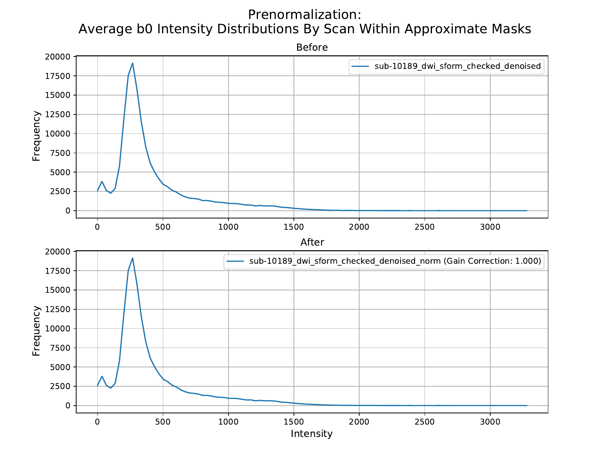

**What it shows.** The intensity histogram of the averaged b0 inside an approximate brain mask for each input scan, before and after the scans are scaled to match the first one. The gain correction factor is in the legend.

**Check.**

- With several scans, the "Before" histograms should overlap. Factors far from 1 mean the scanner applied different gains to the scans. The pipeline corrects that, and warns on the Methods page when the difference is above 5 percent, but a large gain difference is worth knowing about because it often means the scans came from different sessions or reconstructions.
- With one scan the page is a formality: the factor is 1.000 and before and after are identical, as here.

### Synb0-DisCo

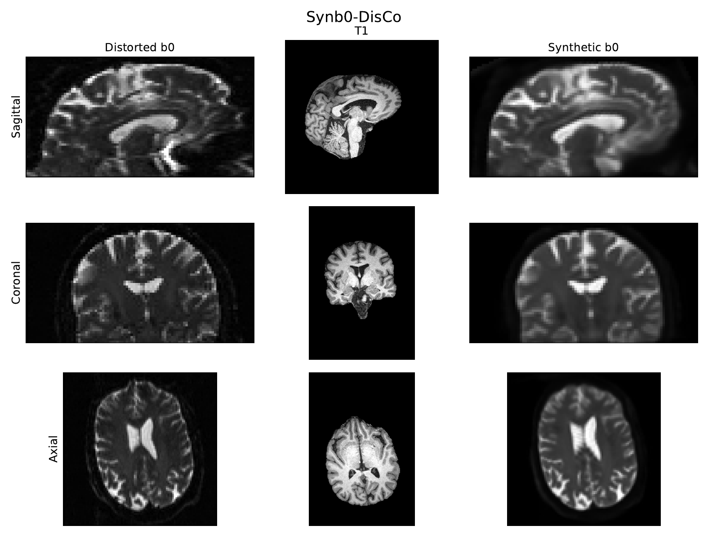

Only present when no reverse phase-encoded image was given and a T1 was.

**What it shows.** The distorted b0 that went in, the T1 used, and the synthetic undistorted b0 that came out. Topup then estimates the field from the distorted and synthetic pair.

**Check.**

- The T1 matches the option used: skull-stripped when `--synb0 stripped`, with skull when `--synb0 raw`. A skull-stripped T1 that still has scalp or neck, or a raw T1 that was accidentally stripped, degrades the synthesis.
- The synthetic b0 looks like a b0 of the T1's anatomy: same brain outline, ventricles in the same place, frontal lobe and brainstem with the T1's shape rather than the distorted b0's. It is blurrier than a real b0 and that is normal.
- The three columns are in register. If the synthetic b0 is shifted or rotated relative to the distorted b0, the T1 to b0 registration failed and the distortion correction will be wrong.

**In this example.** The stripped T1 is clean and the synthetic b0 reproduces its frontal shape. The axial T1 row is a different slice than the b0 rows because the T1 is shown in its own space; that is expected.

### Preprocessing and Masks

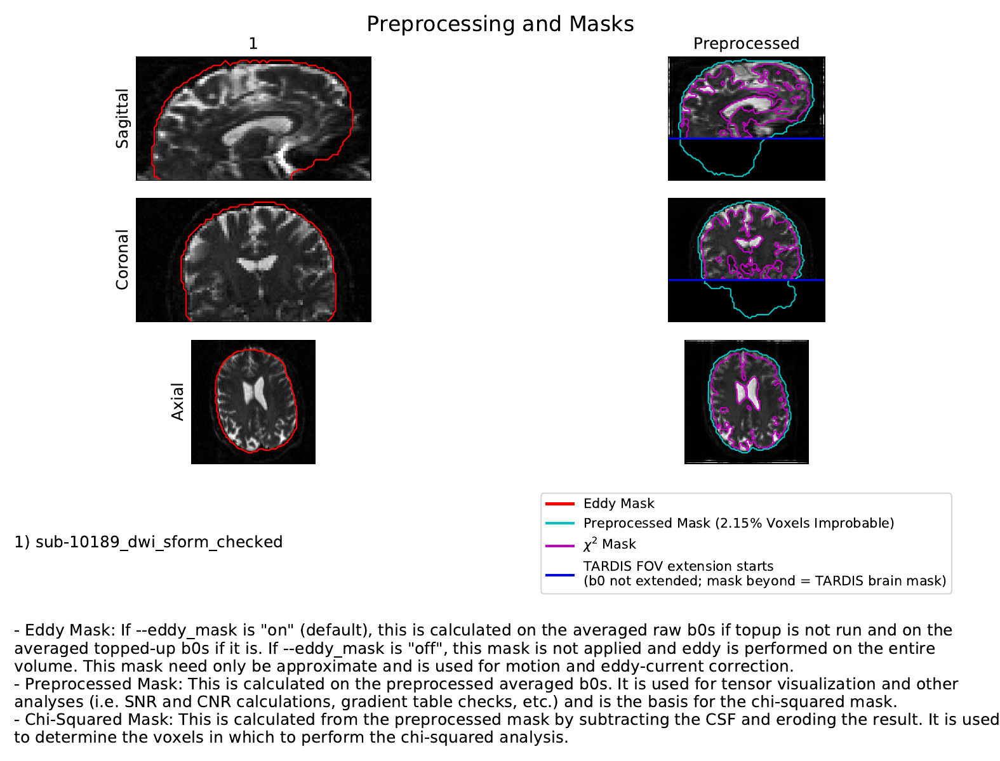

**What it shows.** Left, the first b0 of each raw scan with the eddy mask in red. Right, the preprocessed averaged b0 with the preprocessed brain mask in cyan and the chi-squared mask in magenta. When TARDIS ran, a blue line marks where the field-of-view extension starts; the b0 is not extended, so it is black beyond the line and the cyan contour there is the TARDIS brain mask.

**Check.**

- The distortion is gone on the right. Compare the frontal lobe and brainstem shape against the raw b0 on the left. Residual stretching means the readout time, direction, or synthetic b0 was wrong.
- The cyan mask follows the brain surface without cutting into cortex and without including eyes, scalp or neck. Everything downstream (SNR, CNR, FA statistics, the chi-squared mask) uses this mask.
- The magenta chi-squared mask sits inside the brain and excludes the ventricles; it is the cyan mask minus CSF, eroded by one voxel.
- The percentage of improbable voxels in the legend. These are mask voxels where the minimum b0 signal is below the minimum diffusion-weighted signal, which should not happen physically. A few percent is normal, mostly at the brain edge and in CSF. Values well above that mean a noisy scan, a mask that includes non-brain, or severe artifacts.

**In this example.** The eddy mask hugs the raw brain, the preprocessed b0 is undistorted, and 2.15 percent of voxels are improbable, which is typical.

### Eddy: motion, outliers and chi-squared fit

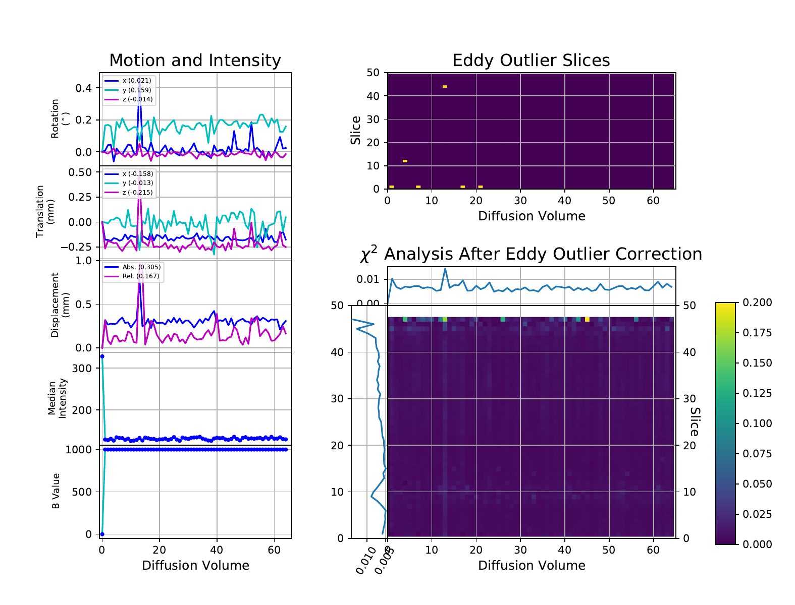

This is the page that most often decides whether a scan passes.

**What it shows.**

- Left column, one point per diffusion volume: rotation and translation estimated by eddy (the averages are in the legends), absolute and relative RMS displacement, the median intra-mask intensity, and the b-value of the volume.
- Top right: the slices eddy flagged as outliers (signal dropout from motion during the diffusion encoding) and replaced by its model prediction. Each yellow mark is one slice of one volume.
- Bottom right: the chi-squared matrix, slice by volume, of the tensor fit after eddy. It is the ratio of the fit's sum-squared error to the sum-squared signal of the slice, capped at 0.2 on the color scale, with the per-volume median above and the per-slice median to the left.

**Check.**

- **Motion.** Rotations under about a degree and translations under about a millimeter are routine. Relative displacement is the sensitive one: a spike marks a volume where the subject moved between two consecutive volumes. One or two spikes with a matching outlier slice are fine. Many spikes, or a steady drift across the run, mean the data were acquired on a moving subject and the averages in the legend should be recorded.
- **Median intensity.** The b0 volumes are bright and the diffusion-weighted volumes form a flat line per shell. A volume whose intensity drops below its shell has signal loss that eddy may not have caught.
- **Outlier slices.** Isolated marks are normal. A vertical stripe (many slices in one volume) is a volume ruined by motion. A horizontal stripe (one slice in many volumes) is usually a hardware or spike artifact on that slice. The imputed slices are a model prediction, not data, so a scan with dozens of outlier slices should be treated with caution even though it looks clean afterwards.
- **Chi-squared.** The matrix should be dark everywhere. Bright columns are bad volumes; bright rows are bad slices; a bright block is a region where the tensor fit failed, usually from residual distortion or a mask that includes non-brain. The top and bottom slices often read slightly higher because of partial brain coverage and that is not a problem on its own.

**In this example.** One motion event near volume 13 (relative displacement about 0.75 mm) with a matching outlier slice, a handful of other outlier slices on the lowest slices, and a chi-squared matrix that is dark apart from the topmost slice. This passes.

### TARDIS FOV Extension

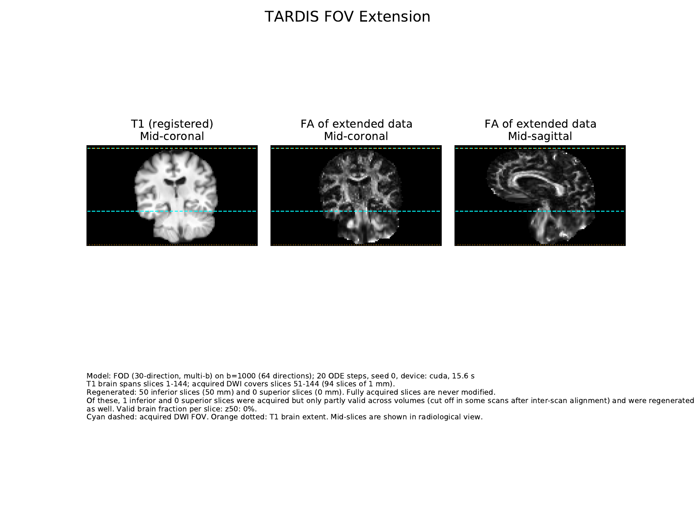

Only present when a T1 was given and `--tardis on` (the default). TARDIS regenerates the brain slices that the acquisition cut off at the top or bottom of the field of view, using the co-registered T1 and the acquired diffusion data. The acquired slices are never modified.

**What it shows.** The T1 registered to the diffusion data, and the FA of the extended data in mid-coronal and mid-sagittal views. The cyan dashed lines are the acquired field of view; the orange dotted lines are the extent of the brain in the T1. The text block reports which model and shell were used, the device, the run time, how many slices were regenerated at each end, and how many acquired edge slices were only partly valid across volumes and were regenerated as well.

**Check.**

- The T1 and the FA are in register: the brain outline, the ventricles and the corpus callosum sit in the same place in both coronal panels. A misregistration here means the extension was synthesized in the wrong place.
- Within the acquired field of view (between the cyan lines) the FA is the normal PreQual FA. Beyond it the FA should continue the anatomy without a seam: brainstem and cerebellar white matter at the bottom, the superior corona radiata at the top.
- How much was regenerated. A few slices at one end is the common case and the result is reliable. A large extension (tens of millimeters, as here) is an extrapolation of a region the scanner never saw; it is good enough for the pipeline's own purposes, but check the next page carefully before using the extended data for anything quantitative in that region.

**In this example.** The acquisition cut off the cerebellum and brainstem; TARDIS regenerated 50 inferior slices on the GPU in 16 seconds. The T1 and FA line up, and the brainstem FA continues below the cyan line.

### TARDIS Imputed Slices

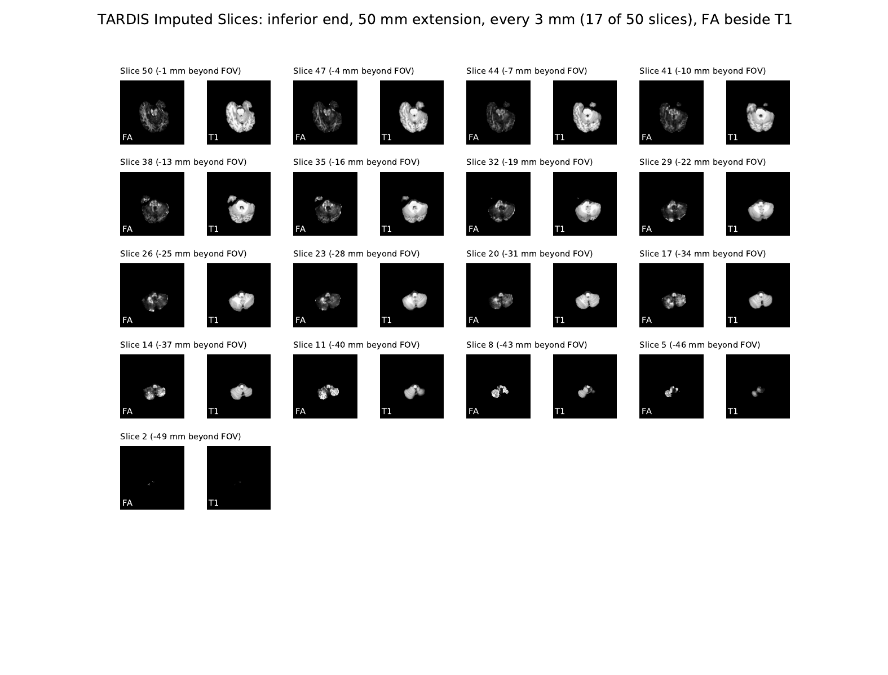

One page per extended end. Each pair is one regenerated axial slice: the extended FA on the left and the registered T1 on the right, with the distance beyond the acquired field of view in the label. Every slice is shown for small extensions; larger ones are subsampled.

**Check.**

- In every pair the FA brain outline matches the T1 brain outline. FA outside the T1 brain, or a T1 slice with brain where the FA is empty, means the extension used a wrong mask or registration.
- White matter appears where the T1 says it should: bright middle cerebellar peduncles and corticospinal tract in the brainstem at the bottom of the brain, bright centrum semiovale at the top.
- The FA does not degrade into noise or a flat gray as the distance beyond the field of view grows.

**In this example.** The outlines match down to the last slice, and the cerebellar peduncles and brainstem tracts are visible. The deepest slices are small cerebellar tissue and show little FA, as the T1 would predict.

### Gradient Check

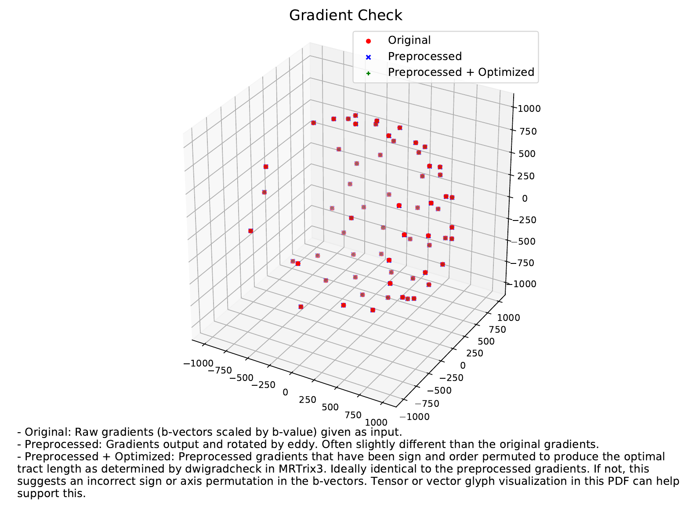

**What it shows.** The b-vectors scaled by their b-values: as supplied (red dots), as rotated by eddy (blue crosses) and after `dwigradcheck` has permuted and flipped them to maximize tract length (green pluses).

**Check.**

- Blue sits on red, up to the small rotation eddy applied for motion.
- Green sits on blue. This is the one that matters: if the green pluses are mirrored or swapped relative to the blue crosses, the supplied b-vectors have a sign flip or an axis permutation. Confirm it on the Tensors page (the colors will be wrong there) and fix the b-vectors before using the data. The corrected gradient table is in `OPTIMIZED_BVECS/`, but the preprocessed outputs are not changed automatically.
- The points cover the sphere. A half sphere is normal for schemes that do not include antipodal directions. Clumped or missing directions mean a scheme problem or removed volumes (see the Methods warnings).

**In this example.** All three sets coincide.

### Preprocessed b=0 and per-shell averages

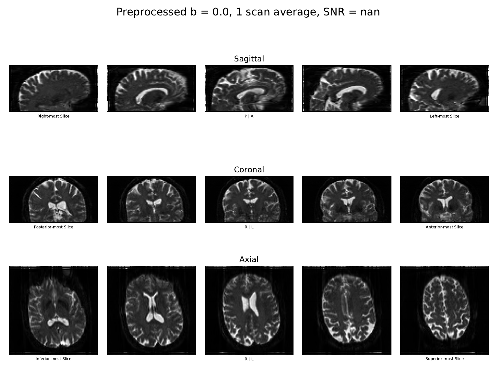

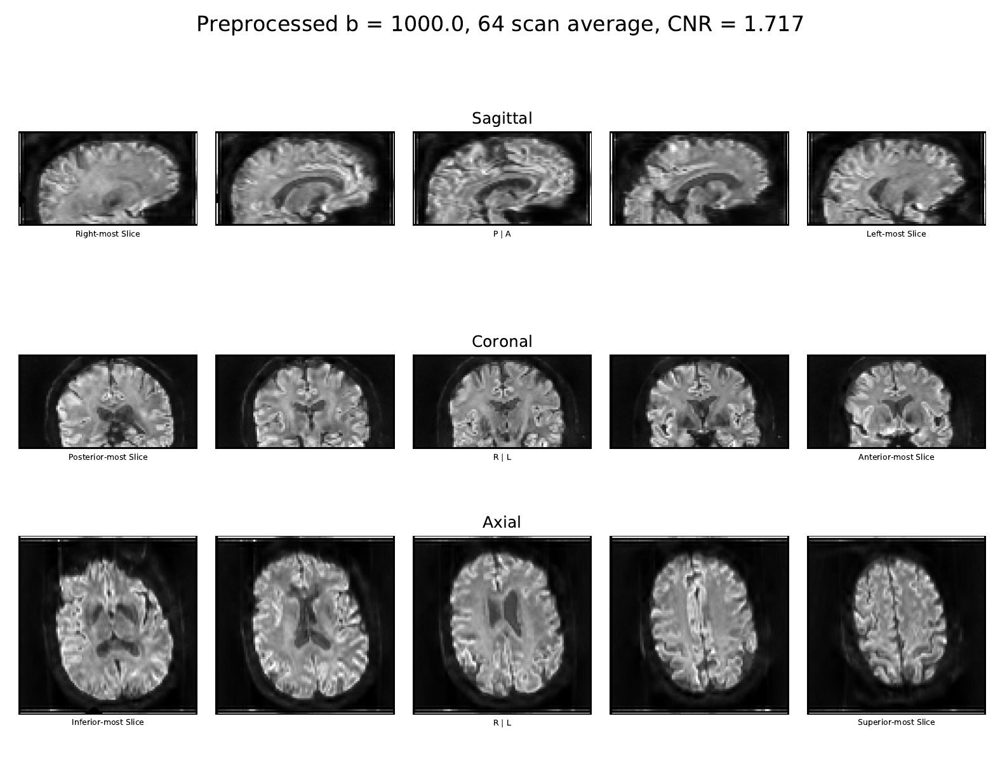

One page per unique b-value. Each shows the average of all volumes in that shell after preprocessing, as five sagittal, coronal and axial slices across the brain, with the number of volumes averaged and the median SNR (b=0) or CNR (diffusion weighted) that eddy computed inside the brain mask. These pages show the data as acquired, without TARDIS.

**Check.**

- No remaining distortion, ghosting, slice-to-slice striping or dark bands inside the brain. Signal dropout that survived outlier replacement shows up as a dark region on one side of the brain.
- The b=0 average is uniform within tissue, bright CSF. The diffusion-weighted average is gray-matter bright and white-matter darker with a smooth appearance across slices.
- The SNR and CNR values are comparable to other scans of the same protocol. There is no absolute threshold; a CNR half that of its neighbors is the sign to look for. SNR is reported as `nan` when the scan has a single b0, because eddy needs at least two b0 volumes to estimate it. That is a property of the acquisition, not an error.
- A thin black band at the phase-encoding edges of the axial slices is expected. Voxels that the susceptibility correction sampled from outside the acquired field of view are set to zero rather than left with interpolation overshoot, and they fall at the anterior and posterior edges for j encoding.

**In this example.** One b0, so SNR is `nan`; the b=1000 CNR is 1.717 from 64 volumes. The images are clean apart from the expected edge bands.

### Tensors

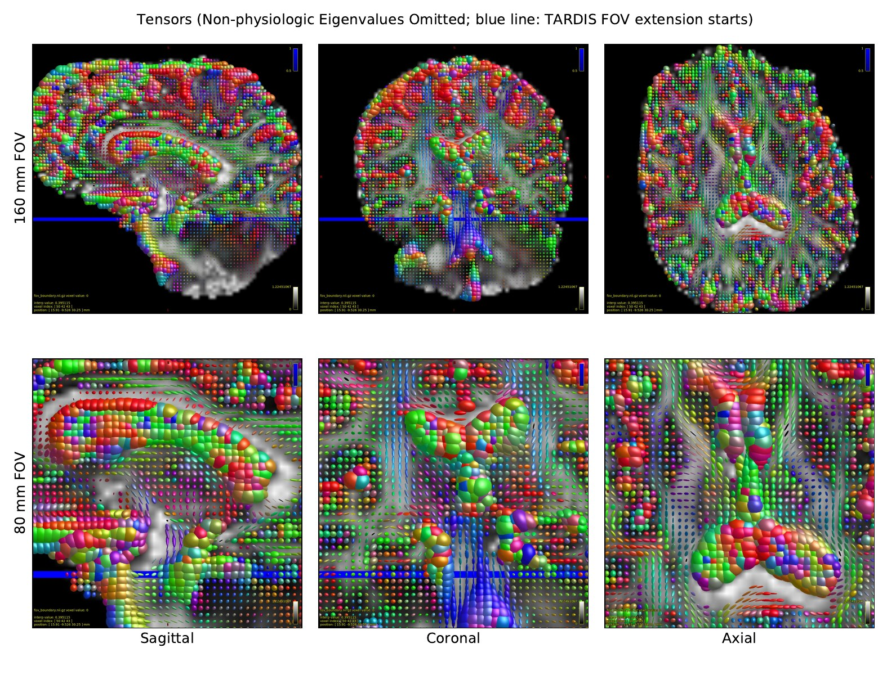

**What it shows.** The fitted tensors (or principal eigenvectors with `--glyph_type vector`) as glyphs on the FA, at a full and a zoomed field of view. Color is orientation: red left-right, green anterior-posterior, blue superior-inferior. Tensors with negative eigenvalues or eigenvalues above the diffusivity of water are not drawn. Below the blue line the glyphs come from the TARDIS data.

**Check.**

- Corpus callosum red, cingulum green, corticospinal tract and internal capsule blue, in all three views. Any other arrangement means the b-vectors are wrong (see Gradient Check).
- Glyphs are elongated and coherent inside white matter and small, round ones in gray matter and CSF. White matter full of randomly oriented glyphs is a noisy or badly corrected scan.
- No large holes in white matter, which would be omitted non-physiologic tensors.

**In this example.** Colors and coherence are as expected, including the brainstem and cerebellar glyphs below the blue line.

### FA

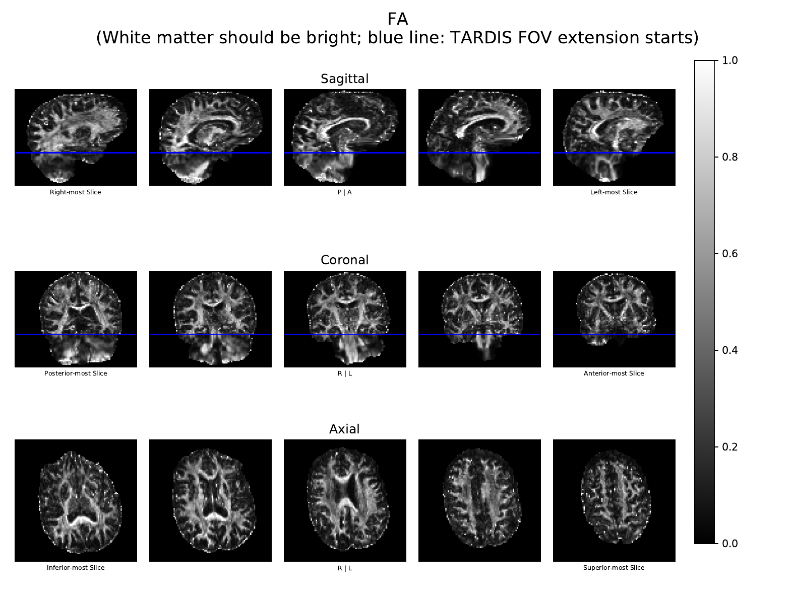

**What it shows.** Fractional anisotropy from 0 (black) to 1 (white) across the same slices as the shell pages. White matter should be bright, gray matter dark, CSF black. Below the blue line the map comes from the TARDIS data.

**Check.**

- The major tracts are bright and sharp: corpus callosum, internal capsule, corona radiata, cerebellar peduncles.
- Gray matter and CSF are dark. An FA map that is uniformly bright, or bright in the ventricles, is noise-dominated.
- A ring of bright voxels at the brain edge is common. It comes from partial volume with the skull and from the mask edge and is not a failure, but it should not extend inward.
- Across the blue line the map is continuous. A visible step in brightness or sharpness marks a TARDIS problem.

### Median FA per ROI

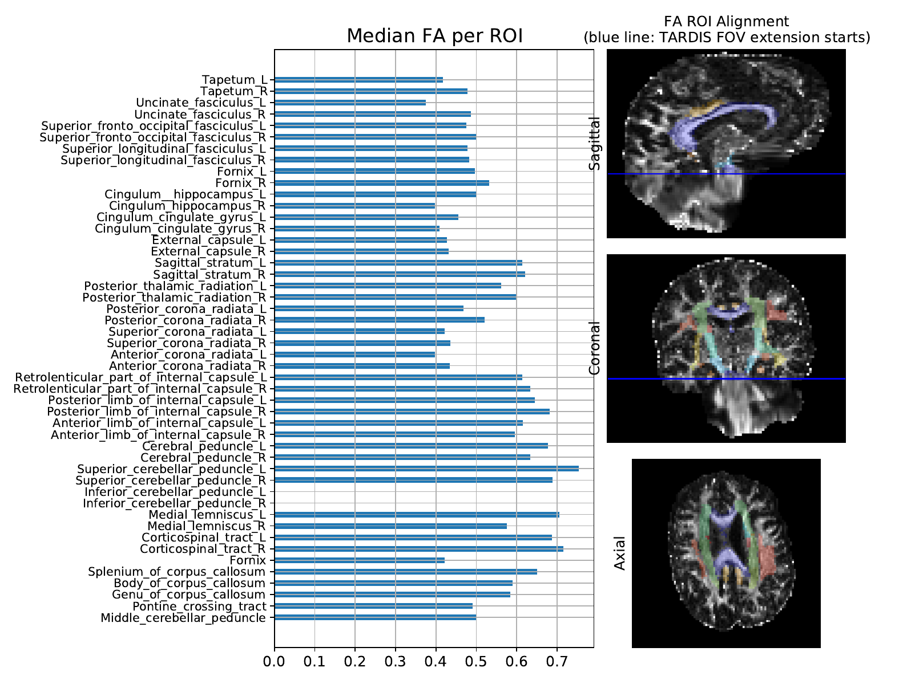

**What it shows.** The ICBM-DTI-81 (JHU) white matter atlas was registered non-rigidly to the subject's FA, and the median FA of each of the 48 tract labels is plotted. The three images show some of the labels drawn on the subject FA so you can judge the registration. The same numbers are in `STATS/stats.csv`.

**Check.**

- The atlas overlay sits on the right structures: the corpus callosum label on the corpus callosum, the corticospinal tract on the internal capsule and brainstem. A shifted or stretched overlay means the registration failed and every ROI value on this page is unusable.
- Major tracts read in the normal range, roughly 0.5 to 0.7 for the corpus callosum, internal capsule and corticospinal tract, and lower for small or peripheral tracts. A whole page of low values is a bad registration or a noisy scan.
- Individual ROIs at or near zero. The ROI medians are computed on the acquired data only, not on the TARDIS extension, so tracts that lie partly or fully outside the acquired field of view read low or zero. That is a limitation of the acquisition, not a processing failure, but those ROI values must not be used.

**In this example.** The registration is good and the major tracts read 0.55 to 0.75. The inferior cerebellar peduncles and the left hippocampal cingulum are near zero because they lie below the acquired field of view (compare with the blue line on the right), and the left uncinate is low for the same reason.

### MD

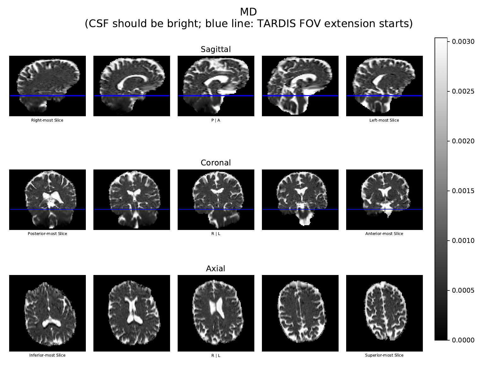

**What it shows.** Mean diffusivity from 0 to 0.003 mm²/s (the diffusivity of water at body temperature). CSF should be bright and tissue dark and uniform. Below the blue line the map comes from the TARDIS data.

**Check.**

- Ventricles and sulcal CSF bright, gray and white matter a uniform dark gray with little contrast between them.
- No bright speckle inside tissue (noise or residual motion), no dark ventricles (a fit or b-value problem), and no global brightening or darkening compared with other scans of the same protocol.

## Deciding

| Result | When |
|---|---|
| Pass | Masks follow the brain, distortion corrected, motion small with few outliers, chi-squared dark, gradients consistent, tensor colors right, FA and MD look like FA and MD. |
| Pass with notes | Same, but with something to record: a motion event, a handful of outlier slices, an ROI that falls outside the field of view, a large TARDIS extension, a single b0 so no SNR. Write the note down with the scan ID; cohort analyses will want it. |
| Fail, fix and rerun | Wrong phase encoding axis or readout time, wrong T1 or T1 not stripped when it should be, b-vector flip or permutation found on the Gradient Check page, mask that misses brain or includes non-brain. These are input problems; the pipeline will give a good result once they are fixed. |
| Fail, exclude | Motion or outlier slices through most of the run, a chi-squared matrix with bright columns or rows across the brain, residual distortion after a correct configuration, FA that is noise. No rerun will fix the data. |

Record the motion averages, the SNR and CNR per shell and the ROI medians from `STATS/stats.csv` for every scan you keep; screening a cohort on those columns catches outliers that are easy to miss page by page.

## Pages you may see that are not in this example

| Page | When it appears | What to look for |
|---|---|---|
| Gibbs de-ringing | `--degibbs on` | Residuals concentrated at high-contrast edges (ventricle borders), not spread across tissue. |
| Rician correction | `--rician on` | Per-shell intensity histograms shift slightly down after correction, nothing else changes. |
| Gain QA of Inputs | `--prenormalize off` | Same plot as the prenormalization page, for information only; the scaling is not applied. |
| Postnormalization | `--postnormalize on` | Histograms of the scans line up after preprocessing. |
| N4 Bias Field Correction | `--correct_bias on` | A smooth field and a flatter image after correction, no new structure introduced. |
| Nonlinear Gradient Field Correction | `--correct_grad on` | The corrected b-value maps vary smoothly and the field determinant is near 1 in the center of the magnet. |
| Several scans on PE Direction, Prenormalization and Preprocessing and Masks | More than one input scan | Consistent axis, overlapping histograms, and matching eddy masks across scans. |
| No Synb0-DisCo page | A reverse phase-encoded scan was given, or no T1 | Topup used the reverse scan (check the PE Direction page shows opposite distortion) or did not run at all (check the Warnings). |
| No TARDIS pages | No T1, `--tardis off`, or TARDIS skipped or failed | The Methods warnings say why. The rest of the report is unaffected and the brain figures show the data as acquired, without a blue line. |
